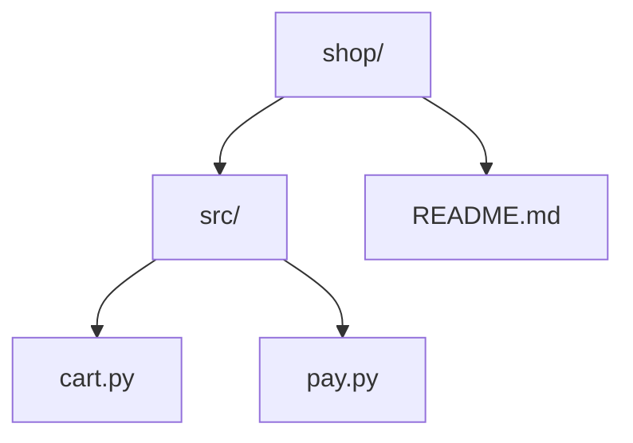

<!-- ramani: README.md -->
<h1 align="center">ramani</h1>

<p align="center">
  <strong>Every file knows where it lives.</strong><br>
  One comment at the top of each file says where it sits in your project, and it follows the file when it moves.
</p>

<p align="center">
  <a href="https://pypi.org/project/ramani/"></a>
  <a href="https://www.python.org/"></a>
  <a href="https://docs.astral.sh/uv/"></a>
  
  
</p>

<p align="center">
  <a href="#install">Install</a> ·
  <a href="#usage">Usage</a> ·
  <a href="#map-your-project">Map your project</a> ·
  <a href="#use-it-in-ci">CI</a> ·
  <a href="#configuration">Configuration</a> ·
  <a href="#supported-files">Supported files</a>
</p>

> **ramani** _(ra-MA-ni)_ is Swahili for **"map"**. That is the whole idea: ramani draws a map of your project _inside_ the project. Each file carries one comment with its own path, kept correct as files are renamed and moved, and the same tool can print the entire project as a tree, a list, an outline, JSON or a diagram.

```python
# ramani: src/shop/billing/pay.py
def pay(): ...
```

## Why

Files travel without their address. They get pasted into chats, issues, code reviews and AI prompts, and the question "which file is this, again?" comes up every time. With ramani the path is part of the file, so it travels with it.

## Features

- 🧭 **Move-aware.** Rename or move a file, run ramani again, and its comment follows. Nothing is duplicated.
- 🪶 **Careful placement.** The comment goes after shebangs, encoding lines, XML declarations and Markdown front matter, and never turns a docstring into a plain string.
- 🗂️ **Knows 60+ file types.** Python, JavaScript, Go, Rust, SQL, HTML, CSS, Markdown, Dockerfile and more, each with the right comment syntax. Add your own in one line.
- 🙈 **Respects your ignores.** Built-in lists for `__pycache__`, `node_modules` and friends, every `.gitignore` it finds (nested ones too), and flags, environment variables or `pyproject.toml` settings for the rest.
- 🗺️ **Maps your project five ways.** Tree, flat paths, Markdown outline, JSON or a Mermaid diagram, and one flag copies any of them to your clipboard.
- 💾 **Saves a snapshot.** `-o` writes any map to a file you choose, or to a git-ignored `.ramani/` folder, ready to share.
- 🛑 **Asks before big runs.** Pointed at a huge folder (say, a whole drive) by mistake? ramani asks before writing to more than 1000 files. `--yes` skips the question.
- 🔍 **CI-friendly.** `--check` exits with code 1 when any comment is missing or stale. `--dry-run` writes nothing. Key settings can come from `RAMANI_*` environment variables.
- 🧹 **Reversible.** `--remove` strips every comment ramani added.

## Install

```bash
uv tool install ramani      # install the command globally (recommended)
uvx ramani --dry-run        # or run it once without installing anything
pipx install ramani         # pipx or plain pip work too: pip install ramani
```

Prefer to pin it to a single project, for CI or pre-commit? Add it as a dev dependency and run it through `uv run`:

```bash
uv add --dev ramani
uv run ramani --check
```

Then, inside a project:

```bash
ramani --dry-run            # see what would change
ramani                      # do it
```

## Usage

Point it at a folder (default: the current one) or a single file. Paths in the comments are relative to that folder.

```console
$ ramani
added     docs/setup.md
added     src/shop/cart.py
added     src/shop/index.html
added     src/shop/pay.py
added     README.md
5 added, 1 unsupported
no comment style for: .json x1
  add one with -c EXT=START[,END] or [tool.ramani.comments] in pyproject.toml
```

The comment uses each language's own syntax, and sits where it can't break anything:

```python
# ramani: src/shop/cart.py
"""Cart logic."""

import json
```

```html
<!-- ramani: src/shop/index.html -->
<h1>Hi</h1>
```

```text
---
title: Setup
---
<!-- ramani: docs/setup.md -->
# Setup
```

### When a file moves

Move `pay.py` into a new `billing/` folder and run ramani again. It recognises its own comment, sees the path is out of date, and rewrites it. Untouched files stay untouched.

```text
  file                  first line
  ────────────────────  ───────────────────────────────
  src/shop/pay.py       # ramani: src/shop/pay.py
        │
        │  mv src/shop/pay.py src/shop/billing/
        ▼
  src/shop/billing/pay.py   # ramani: src/shop/pay.py          ← stale
        │
        │  ramani
        ▼
  src/shop/billing/pay.py   # ramani: src/shop/billing/pay.py  ← fixed
```

```console
$ mkdir src/shop/billing && mv src/shop/pay.py src/shop/billing/
$ ramani
updated   src/shop/billing/pay.py
4 unchanged, 1 unsupported, 1 updated
```

### Big folders ask first

If a run would write to more than 1000 files, ramani stops and asks before touching anything. That keeps a stray `ramani` in your home folder or on a whole drive from rewriting everything under it.

```console
$ cd /
$ ramani
ramani: more than 1000 files under /. Continue? [y/N] n
aborted, nothing was changed
```

- `-y, --yes` skips the question.
- `--max-files N` (or `RAMANI_MAX_FILES=N`) changes the limit (default: 1000).
- Without a terminal (CI, pipes) and without `--yes`, ramani aborts with exit code 1 rather than waiting for an answer.
- `--dry-run`, `--check` and every map format write nothing, so they never ask.

The count follows the same ignore rules as marking, and stops as soon as the limit is passed, so ramani doesn't scan a whole drive just to count.

## Map your project

ramani can print the whole project, using the same ignore rules as marking, so you see exactly the files it works on. Nothing is written. Pick a format with `-f` (`-t` is shorthand for `-f tree`):

| Format     | Flag combination | Best for                                        |
| ---------- | ---------------- | ----------------------------------------------- |
| `tree`     | `-t`, `-f tree`  | Reading in a terminal, pasting into chats       |
| `paths`    | `-f paths`       | Scripts: `xargs`, `grep`, `wc -l`               |
| `markdown` | `-f markdown`    | Issues, pull requests and docs                  |
| `json`     | `-f json`        | Tools, dashboards, anything that parses         |
| `mermaid`  | `-f mermaid`     | A diagram that GitHub and many doc sites render |

Add `--copy` to any of them to put the result on your clipboard.

### Tree

Folders come first.

```console
$ ramani --tree
shop/
├── docs/
│   └── setup.md
├── src/
│   └── shop/
│       ├── billing/
│       │   └── pay.py
│       ├── cart.py
│       └── index.html
├── README.md
└── data.json
```

### Paths

One file per line, relative to the folder you pointed at. Empty folders are left out.

```console
$ ramani -f paths
docs/setup.md
src/shop/billing/pay.py
src/shop/cart.py
src/shop/index.html
README.md
data.json
```

Handy in pipelines:

```bash
ramani -f paths | xargs wc -l
```

### Markdown

A nested bullet list that renders cleanly anywhere Markdown does.

```console
$ ramani -f markdown
- `shop/`
  - `docs/`
    - `setup.md`
  - `src/`
    - `shop/`
      - `billing/`
        - `pay.py`
      - `cart.py`
      - `index.html`
  - `README.md`
  - `data.json`
```

### JSON

Nested objects with a `name`, a `type` (`dir` or `file`) and, for folders, `children`.

```console
$ ramani -f json
{
  "name": "shop",
  "type": "dir",
  "children": [
    {
      "name": "docs",
      "type": "dir",
      "children": [{ "name": "setup.md", "type": "file" }]
    },
    { "name": "README.md", "type": "file" }
  ]
}
```

_(Abridged here; the real output is indented one key per line.)_

### Mermaid

A `flowchart` you can paste straight into a README, an issue or a wiki. GitHub draws it as a diagram; elsewhere you will see the source.

```console
$ ramani -f mermaid
flowchart TD
    n0["shop/"]
    n1["src/"]
    n0 --> n1
    n2["cart.py"]
    n1 --> n2
    n3["pay.py"]
    n1 --> n3
    n4["README.md"]
    n0 --> n4
```



### Combine with other flags

```bash
ramani --copy                       # print the tree and copy it
ramani ./src -f markdown --copy     # outline of ./src on your clipboard
ramani -f paths -d tests -e .md     # paths, leaving out tests and Markdown
```

> On Linux, the clipboard needs `xclip`, `xsel` or `wl-clipboard` installed. If none is available the map is still printed, with a note on stderr and exit code 1.

### Save a map to a file

`--copy` reaches the clipboard; `-o` reaches a file you can attach, commit or upload.

```bash
ramani -o                         # save to .ramani/map.txt
ramani -f json -o                 # save to .ramani/map.json
ramani -o docs/structure.md       # save exactly there
ramani ./src -o                   # map ./src, snapshot in ./src/.ramani/
```

The format comes from the extension, and `-f` always wins:

| Extension          | Format     |
| ------------------ | ---------- |
| `.txt`             | `tree`     |
| `.md`, `.markdown` | `markdown` |
| `.json`            | `json`     |
| `.mmd`, `.mermaid` | `mermaid`  |

An unknown extension needs `-f` (`ramani -o map.out -f paths`). With no file name, the extension follows the format: `.txt` for `tree` and `paths`, `.md`, `.json` or `.mmd` for the others. Files are plain text, never coloured, and nothing is printed to the terminal except a short note on stderr.

**The `.ramani/` folder** is created only when you run `-o` with no file name. It gets a `.gitignore` holding a block that ramani manages (`*`), so snapshots never reach git. Lines you add to that file are kept; ramani only rewrites its own block. The folder is always skipped by ramani itself, even with `--no-gitignore`.

> **Careful:** an explicit `-o` path inside your project (say `-o map.md`) is a normal file. ramani leaves it out of its own map, but a later marking run will add a path comment to it, and `--check` will flag it. Save snapshots to `.ramani/`, outside the project, or list the file in `.gitignore`.

Put the folder before `-o`: `ramani src -o` maps `src`, whereas `ramani -o src` means "save to a file called `src`" and stops with a hint.

## Use it in CI

`--check` changes nothing and exits with 1 if any comment is missing or stale, so stale paths never reach your main branch. It never asks for confirmation. A real run (without `--check` or `--dry-run`) over more than 1000 files needs `--yes` when there is no terminal.

**GitHub Actions**

```yaml
- uses: astral-sh/setup-uv@v7
- run: uvx ramani --check
  env:
    RAMANI_IGNORE_DIR: gen,build*
```

**pre-commit**

```yaml
repos:
  - repo: local
    hooks:
      - id: ramani
        name: ramani
        entry: uvx ramani --check
        language: system
        pass_filenames: false
```

## Options

| Option                          | What it does                                                                                                                    |
| ------------------------------- | ------------------------------------------------------------------------------------------------------------------------------- |
| `PATH`                          | Folder or file to process (default: current folder)                                                                             |
| `-e, --ignore-ext EXT`          | Also skip this extension, e.g. `-e .txt` (repeatable; also `ignore-ext` in `pyproject.toml`, `RAMANI_IGNORE_EXT`)               |
| `-d, --ignore-dir NAME`         | Also skip this folder name or glob, e.g. `-d "build*"` (repeatable; also `ignore-dir` in `pyproject.toml`, `RAMANI_IGNORE_DIR`) |
| `-c, --comment EXT=START[,END]` | Comment style for an extension or file name (repeatable)                                                                        |
| `--no-gitignore`                | Ignore `.gitignore` files (also `RAMANI_NO_GITIGNORE=1`)                                                                        |
| `-n, --dry-run`                 | Show what would change, write nothing                                                                                           |
| `--check`                       | Dry run that exits 1 if anything is missing or stale                                                                            |
| `--max-files N`                 | Ask before writing to more than `N` files (default: 1000; also `RAMANI_MAX_FILES`)                                              |
| `-y, --yes`                     | Don't ask for confirmation, even for a large number of files                                                                    |
| `--remove`                      | Strip ramani comments instead of adding them                                                                                    |
| `-t, --tree`                    | Print the folder tree instead of marking files                                                                                  |
| `-f, --format FORMAT`           | Map the project as `tree`, `paths`, `markdown`, `json` or `mermaid` instead of marking files                                    |
| `--copy`                        | Copy the map to the clipboard (implies `--tree` unless `-f` is given)                                                           |
| `-o, --output [FILE]`           | Save the map to `FILE` (format from its extension or `-f`); with no `FILE`, to `.ramani/map.<ext>`. Put `PATH` first            |
| `-V, --version`                 | Print the installed version and exit                                                                                            |
| `-v, --verbose`                 | Also list unchanged files                                                                                                       |

`-t`, `-f`, `--copy` and `-o` can't be combined with `--remove` or `--check`.

## Configuration

Settings can be given as flags, as environment variables, or once and for all in your `pyproject.toml`.

### Skip file types and folders

Skip extensions with `-e` and folders with `-d` (a name or a glob):

```bash
ramani -e .txt -e .csv -d gen -d "build*"
```

or list them in `pyproject.toml` (the leading dot on extensions is optional):

```toml
[tool.ramani]
ignore-ext = [".txt", ".csv"]
ignore-dir = ["gen", "build*"]
```

Flags, environment variables and `pyproject.toml` add to each other and to the built-in ignores, so nothing is overridden.

### Teach ramani a file type

On the command line:

```bash
ramani -c .abc=//                 # line comment
ramani -c ".tpl=<!--,-->"         # block comment: start,end
ramani -c Jenkinsfile=//          # by exact file name
```

or in `pyproject.toml`:

```toml
[tool.ramani.comments]
".abc" = "//"
".tpl" = ["<!--", "-->"]
```

Flags beat `pyproject.toml`, which beats the built-in styles, so you can override those too.

### Environment variables

Handy for CI and shell profiles. The lists add to the flags and `pyproject.toml`; for `RAMANI_MAX_FILES` the flag wins. An invalid number is ignored. `NO_COLOR=1` turns colour off.

| Variable              | Same as          | Example                        |
| --------------------- | ---------------- | ------------------------------ |
| `RAMANI_IGNORE_EXT`   | `-e`             | `RAMANI_IGNORE_EXT=txt,csv`    |
| `RAMANI_IGNORE_DIR`   | `-d`             | `RAMANI_IGNORE_DIR=gen,build*` |
| `RAMANI_MAX_FILES`    | `--max-files`    | `RAMANI_MAX_FILES=5000`        |
| `RAMANI_NO_GITIGNORE` | `--no-gitignore` | `RAMANI_NO_GITIGNORE=1`        |

Lists are comma-separated. Comment styles (`-c`) and `--yes` are flag-only on purpose.

## Supported files

| Comment    | Looks like                  | Files                                                                                                                                    |
| ---------- | --------------------------- | ---------------------------------------------------------------------------------------------------------------------------------------- |
| `#`        | `# ramani: a/b.py`          | `.py` `.pyi` `.sh` `.rb` `.pl` `.r` `.jl` `.ex` `.yml` `.yaml` `.toml` `.cfg` `.tf` `.ps1` `.nix` `Dockerfile` `Makefile` `.gitignore` … |
| `//`       | `// ramani: a/b.ts`         | `.js` `.mjs` `.jsx` `.ts` `.tsx` `.java` `.kt` `.scala` `.c` `.h` `.cpp` `.cs` `.go` `.rs` `.swift` `.dart` `.scss` `.proto` …           |
| `--`       | `-- ramani: a/b.sql`        | `.sql` `.lua` `.hs` `.elm`                                                                                                               |
| `<!-- -->` | `<!-- ramani: a/b.html -->` | `.html` `.htm` `.xml` `.svg` `.vue` `.svelte` `.md` `.markdown`                                                                          |
| `/* */`    | `/* ramani: a/b.css */`     | `.css`                                                                                                                                   |
| `{# #}`    | `{# ramani: a/b.j2 #}`      | `.j2` `.jinja` `.jinja2`                                                                                                                 |
| `{/* */}`  | `{/* ramani: a/b.mdx */}`   | `.mdx`                                                                                                                                   |
| `%`        | `% ramani: a/b.tex`         | `.tex`                                                                                                                                   |

Formats with no comment syntax, such as `.json` and `.csv`, are left alone and listed at the end of each run so nothing is skipped silently. The full table lives in `src/ramani/config.py`.

## How it works

For every file, ramani makes one decision:

```text
                    ┌───────────────────────────────┐
                    │  skip what must stay first:   │
                    │  shebang · encoding line ·    │
                    │  XML declaration · # syntax=  │
                    │  · Markdown front matter      │
                    └───────────────┬───────────────┘
                                    ▼
                  is the next line a ramani comment?
                       │                      │
                      no                     yes
                       │                      │
                       ▼                      ▼
              insert the comment        is the path the same?
                  → added                 │            │
                                         yes           no
                                          │            │
                                          ▼            ▼
                                     do nothing    rewrite that line
                                    → unchanged       → updated
```

Line endings (LF or CRLF) and UTF-8 byte-order marks are preserved. Symlinks, files that are not UTF-8, and binary files (anything containing a NUL byte) are never touched.

## Development

```bash
uv sync
uv run poe test
```

Ramani has two small runtime dependencies: [`termcolor`](https://pypi.org/project/termcolor/) for coloured output and [`pyperclip`](https://pypi.org/project/pyperclip/) for `--copy`. Colour appears only in a terminal; pipes, files and the clipboard get plain text, and `NO_COLOR=1` turns it off.

## License

MIT © Treeolive Tech Ltd. Use it, change it, ship it; just keep the copyright notice.

---

<p align="center">
  <em>"...but the people who know their God shall be strong and do exploits."</em><br>
  Daniel 11:32
</p>
